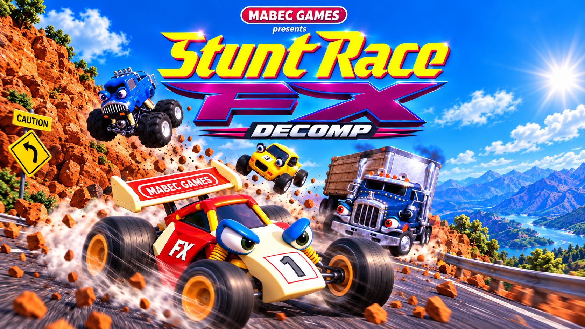
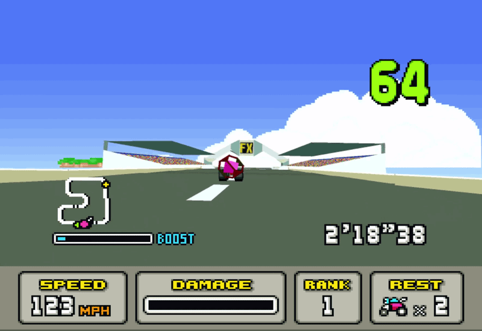
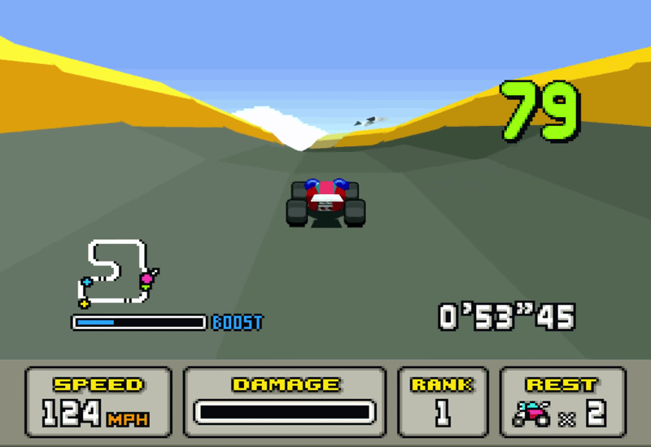

<p align="center">
  
</p>

# Stunt Race FX - DECOMP

> [!WARNING]
> **Work in progress, early stage.** This is an experimental native PC port
> under active development. Expect visual glitches, rough edges and changes
> between builds. Courses, menus and modes beyond the Speed Trax races are
> not fully covered yet. Feedback and bug reports are welcome.

A native PC port of **Stunt Race FX** (SNES, Super FX) aimed at a smooth,
responsive, high-resolution experience - while keeping the original game's
logic exactly as it was.

This is a **fork** of the byte-exact, cycle-exact decompilation by Jeffrey
Wilbur / Strut B, LLC: **[jeff-strutb/stuntracefx](https://github.com/jeff-strutb/stuntracefx)**.
All the hard work of decompiling the game is theirs; this fork builds on their
native port and adds the presentation features below. Their original README
is kept in [docs/UPSTREAM-README.md](docs/UPSTREAM-README.md).

<p align="center">
  
  
</p>
<p align="center"><i>Current build: 60 fps picture, 3D redrawn at 3× resolution with anti-aliasing.</i></p>

**No game data is included.** You need your own ROM of
*Stunt Race FX (USA) (Rev 1)*
(SHA-1 `781e376ff453a83c7bcf72339abe6b842efd9c86`).

---

## What this fork adds

The original game runs its races at roughly 10-20 frames per second on the
console. This fork keeps the game's own logic untouched (the race plays out
identically, verified tick for tick) and rebuilds what you *see* around it:

| Feature | What it does |
|---|---|
| **Smooth 60 fps** | The game's own logic runs at its steady pace with no slowdown ("natural 10"); in-between frames are drawn by re-running the Super FX's own 3D programs with the camera and every object interpolated. |
| **Low input lag (look-ahead)** | The next game ticks are run ahead on a copy of the game, so the picture answers your steering within about 1-2 frames (the original console takes around 20). Predictions are checked against the real game and are exact. |
| **High-resolution 3D** | Every polygon and sprite is captured with its exact, unrounded position and redrawn at 2×, 3× or 4× resolution, with 2×2 anti-aliasing (3× default). Course seams and flicker from the original's rounding are fixed. |
| **Far cars in 3D** | Opponents stay full 3D models up to 4× farther out instead of turning into flat sprites, with wheels, colours and smoothed movement - without changing the race. |
| **HUD in step** | The HUD (countdown lights, rank badges, timer) is taken from the same look-ahead moment as the 3D, so it stays in sync with the picture. |
| **Wide view - EXPERIMENTAL** | Removes the bezel and draws the 3D across the whole screen, corner to corner, with more of the course visible - no stretching. The background panorama, sky and HUD are rebuilt around it. Still rough in places and heavier to run; off by default. |
| **Launcher** | SDL3 launcher: choose and verify your ROM, set resolution, look-ahead, far cars, wide view, speed, fullscreen and vsync. |

Everything is optional: each feature can be turned off (in the launcher or
with the keys below) to get back to the original's look.

## Status

- ✅ Speed Trax races (Novice courses tested most), pause, results.
- 🟡 Wide view (experimental): sprite assets at the edges, some courses not yet checked.
- 🟡 Other courses (e.g. Big Ravine, Night Owl) need a pass each.
- ⬜ Menus, car select and 2-player battle are shown at the original resolution, without in-between frames.
- ⬜ Packaged builds: a Linux AppImage beta exists and will be published here later.

## Running

### From source (Linux)

Requirements: `clang`, `python3`, SDL3 development files (`sdl3` via
pkg-config), and your ROM.

```sh
# the game, built WITHOUT the ROM inside (reads your ROM at start)
HOST=sdl3 ROM_EXTERNAL=1 OUT=build/stuntracefx/port/sdl3 \
  CC="clang -D_GNU_SOURCE -O2" SRFX_ROM="/path/to/Stunt Race FX (USA) (Rev 1).sfc" \
  sh ports/stuntracefx/link.sh
./build/stuntracefx/port/sdl3/stuntracefx --rom "/path/to/Stunt Race FX (USA) (Rev 1).sfc"
```

The build reads the ROM once to generate a table of routine addresses (no
ROM data ends up in the program). The launcher and AppImage are built with
`sh ports/stuntracefx/launcher/build-appimage.sh`.

### Controls

| SNES | Keyboard | Controller |
|---|---|---|
| D-pad | Arrows | D-pad / left stick |
| B / A | Z / X | A / B |
| Y / X | A / S | X / Y |
| L / R | Q / W | Shoulders |
| Start / Select | Return / Tab | Menu / View |

In game: **F3** speed mode · **F4** look-ahead (3/2/1/off) · **F5** 3D resolution ·
**F7** far cars in 3D · **F8** wide view · **Alt+Enter** fullscreen.

## Credits and license

- **Decompilation and native port:** Jeffrey Wilbur / Strut B, LLC -
  [jeff-strutb/stuntracefx](https://github.com/jeff-strutb/stuntracefx),
  released under **CC0 1.0** (see [LICENSE](LICENSE)).
- **This fork** (smooth frames, look-ahead, high-resolution 3D, wide view,
  launcher): Mabec Games. Offered under the same CC0 terms.
- Stunt Race FX is © Nintendo / Argonaut. This project contains no game
  data and is not affiliated with or endorsed by Nintendo.
