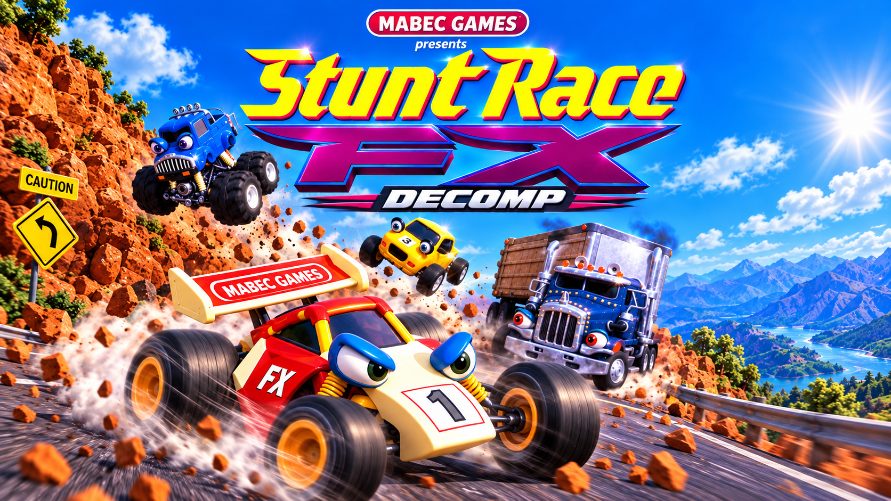

<p align="center">
  
</p>

# Stunt Race FX - DECOMP · Version 1.0 Rebooted

> [!IMPORTANT]
> **The beta 0.2 line has ended.** Development of the 0.x port (beta 0.1 and
> beta 0.2) has stopped. This project now continues as **1.0 Rebooted**,
> built on Jeffrey Wilbur's native game and its GPU engine instead of our
> own redraw layer. The section [Why we rebooted](#why-we-rebooted) explains
> why. The beta 0.2 builds stay on the
> [Releases page](https://github.com/Mabec-games/Stunt-Race-FX-DECOMP/releases/tag/beta-0.2)
> and under the `beta-0.2` tag, but they won't get any more fixes.

A native PC version of **Stunt Race FX** (SNES, Super FX, 1994): the
original game's logic, running natively at 60 fps, with 3D drawn on the GPU
at your display's resolution.

This is a **fork** of the decompilation and native game by Jeffrey Wilbur /
Strut B, LLC: **[jeff-strutb/stuntracefx](https://github.com/jeff-strutb/stuntracefx)**.
Jeffrey did the decompilation, the native game and its engine
([nativeshvc](https://github.com/jeff-strutb/nativeshvc)). 1.0 Rebooted adds
a launcher, a Linux AppImage, desktop controls and fixes on top of that
work. Jeffrey's README is kept in [docs/UPSTREAM-README.md](docs/UPSTREAM-README.md).

<p align="center">
  
</p>
<p align="center"><i>The native game at 16:9 (screenshot from the upstream project).</i></p>

**No game data is included.** You need your own ROM of
*Stunt Race FX (USA) (Rev 1)*
(SHA-1 `781e376ff453a83c7bcf72339abe6b842efd9c86`).

---

## Why we rebooted

Beta 0.1 and 0.2 kept the original's whole picture pipeline. The game's
Super FX 3D programs still drew the picture the way the cartridge does: a
256 × 224 frame, 16-bit coordinates, a 45° view cone and a short object
list. Our features were added on top of that pipeline. We captured what the
chip drew, redrew it at a higher resolution, made in-between frames by
running the chip's programs again with the camera interpolated, and used
look-ahead copies of the game to cut input lag.

That got the races to a smooth 60 fps, but every step beyond that ran into
the same limits:

- **Draw distance.** The cartridge only builds its scenery list from a
  small patch of map cells around the car, and it projects everything in
  16-bit numbers. When we drew farther or wider:
  - side objects overflowed the projection, which made trees and walls
    worse, not better.
  - far scenery appeared with the road "being placed down" in front of the
    car.
  - far fences floated over the Harbor City skyline because the ground
    under them was never drawn.
  - grandstands and trees popped in at the picture's edges.

  Every fix for one of these needed its own special rule (a distance cap, a
  rule for hiding certain objects, a depth test only for far objects).
  Those rules hid the symptom; they didn't remove the cause.
- **Flickering assets.** The original draws its picture over several TV
  frames and rounds every corner to whole pixels. Rebuilding that at high
  resolution, between ticks and ahead of time, caused a steady stream of
  flicker:
  - white road lines flickered in place at the distance where cars turn
    into sprites.
  - a fence section flipped back and forth.
  - signs and fences flickered at Harbor City's screen edges.
  - textures warped on faces cut off at the screen edge.
  - road joints flickered, and 2D sprites flickered just before the start.
  - tunnel entrances showed black layers and flashes.

  Many of these were fixed one at a time (the sign and fence flicker in the
  final round). But each new feature brought new ones, because the
  pictures we were rebuilding were never made to be drawn this way.
- **Wide view.** The 16:9 view stayed experimental. Sprites and objects at
  the edges, the background panorama and the HUD all had to be patched one
  case at a time, and it was heavy to run.
- **Other gaps.** Menus and 2-player races stayed at the original
  resolution with no in-between frames, and a 2-player Battle Trax game
  froze after player 2 pressed Start at car select.

Meanwhile the upstream project rewrote the game as an ordinary native game.
In that version:
- The game's logic is still the original's.
- The picture is described from the game's state and drawn by the GPU
  (Vulkan on Linux and Windows), with a depth test for every pixel.
- View distance is unlimited, and nothing is culled at 45°.
- The game updates 60 times a second, with no slowdown.

That design has no 16-bit picture to rebuild, so the draw distance and
flicker problems above don't come up. We stopped stacking fixes on 0.2 and
moved our work onto that base. That move is 1.0 Rebooted.

## What 1.0 Rebooted adds

On top of the upstream native game:

| Area | What it does |
|---|---|
| **Launcher** | SDL3 launcher (keyboard, controller or mouse). You pick your ROM, and the launcher checks it and builds the game from it once with the bundled builder. Options: window or fullscreen, aspect ratio (including the original 4:3), 3D or original sprite vehicles, 2-player split (side by side or top and bottom), FPS counter. It also has controls and credits pages. |
| **Linux AppImage** | One file. Nothing from the ROM is packed into it. |
| **Desktop controls** | Keyboard and controllers. The first two connected controllers become players 1 and 2, whatever their slots. No touch-style overlay buttons or Escape menu on the desktop. **V** toggles the view from above, and races always start behind the car. |
| **Tunnel openings** | Tunnel mouths are real openings: you can see inside from a distance (Sunset Valley, Aqua Tunnel, Night Cruise). From inside, the exit shows the sky and the course beyond, without leaking through the walls. |
| **Aqua Tunnel** | Underwater, far objects are drawn only along the course ahead, not the other sections of the lap across the water. |
| **GOAL sign** | The GOAL letters are drawn over the road at full size instead of cutting into it. |
| **Screens** | Results text passes over the car, as in the original. The RETIRE? oval is placed where the original picture is, and is no longer stretched. In 2-player mode, the results and quit panels blank the 3D of their half. |
| **2-player** | Each player's camera follows its own car on the same step as in 1-player mode, which removes one step (6 updates) of extra input lag. |
| **Courses** | Battle course mesas are shaded by a fixed sun instead of a flat brown. Harbor City's water sits at the right level, so the water no longer shows over the start's road. |
| **Original sprite cars** | You can show the original's sprite vehicles instead of the 3D models. |

## Status

- ✅ Linux x86_64 AppImage with the launcher.
- ⬜ Windows: the upstream game builds for Windows, but the 1.0 Rebooted
  launcher is Linux only for now.
- 🟡 This is a new base. Please report anything that looks or plays wrong:
  name the course, and include a screenshot or video if you can.
- For upstream's own list of what isn't done yet, see
  [docs/UPSTREAM-README.md](docs/UPSTREAM-README.md#not-done).

## Running

Download `StuntRaceFX-DECOMP-1.0-Rebooted-x86_64.AppImage` from Releases,
make it executable and run it:

```sh
chmod +x StuntRaceFX-DECOMP-1.0-Rebooted-x86_64.AppImage
./StuntRaceFX-DECOMP-1.0-Rebooted-x86_64.AppImage
```

Choose your ROM in the launcher. The first start builds the game into
`~/.local/share/stuntracefx-reboot`, and it is rebuilt only when the ROM or
the bundled game changes. Settings are saved in
`~/.config/stuntracefx/launcher-reboot.cfg`. You need X11 or XWayland and a
Vulkan driver.

### Building from source (Linux)

You need cmake, ninja, gcc or clang, SDL3, glslangValidator, python3,
ffmpeg and linuxdeploy. You also need a checkout of
[nativeshvc](https://github.com/jeff-strutb/nativeshvc) next to this
repository (or set `NSHVC_ROOT`), and Vulkan headers (`VK_INCLUDE`, default
`/usr/include`). From the repository's top:

```sh
sh native/stuntracefx/launcher/build-appimage.sh
```

The output is `../dist/StuntRaceFX-DECOMP-1.0-Rebooted-x86_64.AppImage`.

### Controls (keyboard)

| Action | Key |
|---|---|
| Steer | Arrows |
| Accelerate / Brake | Z / X |
| Boost / Button X | A / S |
| Shift | Q / W |
| Start | Return |
| Camera (Select) | Shift |
| View from above | V |

A controller works like the SNES pad.

## Credits and license

- **Decompilation, native game and nativeshvc engine:** Jeffrey Wilbur /
  Strut B, LLC.
  - Decompilation and game:
    [jeff-strutb/stuntracefx](https://github.com/jeff-strutb/stuntracefx),
    whose own work is **CC0 1.0** (see [LICENSE](LICENSE)).
  - Engine: [jeff-strutb/nativeshvc](https://github.com/jeff-strutb/nativeshvc),
    licensed under **AGPL-3.0**. The game built and shipped in the AppImage
    uses this engine, so the engine's source and its terms apply to those
    builds.
- **1.0 Rebooted** (launcher, AppImage, desktop controls and the fixes
  listed above) and the earlier beta 0.1 and 0.2 port: Mabec Games. Offered
  under the same CC0 terms.
- Stunt Race FX is © Nintendo / Argonaut. This project contains no game
  data and is not affiliated with or endorsed by Nintendo.
