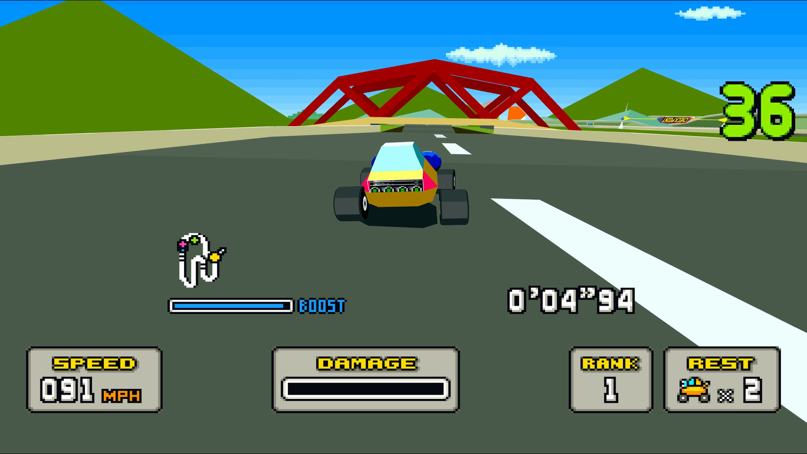
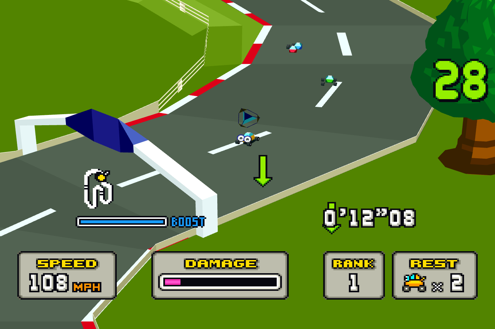
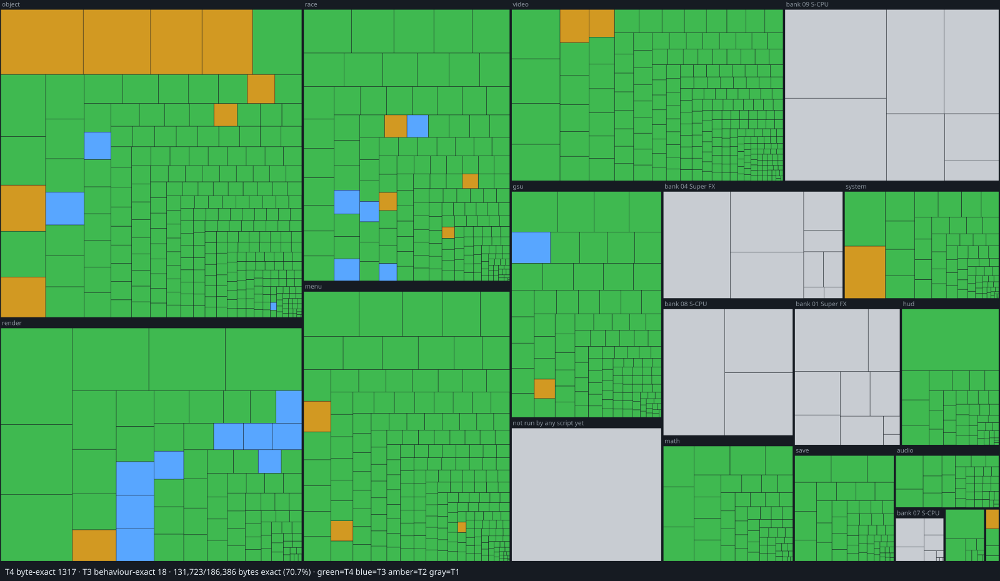

# Stunt Race FX: bit-exact decompilation

## Bring your classic game to a new generation

**Jeffrey Wilbur, Strut B, LLC** ·
[retro@strutb.com](mailto:retro@strutb.com)

If you hold the rights to a classic game, I would love to help it live
again. This repository shows what I do: I take a shipped cartridge back
to readable, commented source that rebuilds the original ROM byte for
byte, prove every routine behaves exactly as the original did, and then
run that source natively on today's hardware, with no emulation of any
processor. From there the game can grow: 60 frames a second, widescreen,
3D drawn at full resolution on the GPU, new camera views, and builds for
macOS, Windows, Linux, iOS and Android, all without losing the game your
players remember. The original stays one switch away.

- **Preserve** it: source you own and can read, maintain and build on,
  recovered from the code that shipped, checked against the original at
  every step.
- **Remaster** it: modern frame rates, screens and controls, on the
  platforms your audience plays on today, with the feel of the original
  intact.
- **Reach new players**, and give your longtime fans the version they
  always pictured.

If you have a game you would like to see again, write to me at
[retro@strutb.com](mailto:retro@strutb.com).

<p>



</p>

*Left: Original mode, the decompiled game on
[nativeshvc](https://github.com/jeff-strutb/nativeshvc) as the cartridge drew
it, at its own pace. Middle: Enhanced mode on the same course, at 60 frames a
second and filling a 16:9 window, the 3D drawn at the window's resolution on
the GPU ([the native build](#playing-it-natively-on-nativeshvc)). Right: the
view from above, Enhanced mode's other camera, the race seen at an angle
from overhead. All three are shots from the native build's headless
renderer, which the GPU's is checked against.*

**Complete: 100% of the game's code is decompiled, behaviour exact and byte
exact.** Started October 11, 2026; behaviour and byte exact October 18, 2026.
The C is the game itself, played natively on
[nativeshvc](https://github.com/jeff-strutb/nativeshvc), a native SNES console
library ([how it plays here](#playing-it-natively-on-nativeshvc)), with no emulation of any processor.

> **Behaviour exact, not cycle exact.** The C states no instruction timing:
> instruction counts are an emulator's bookkeeping and were never part of the
> original source. Where the game's behaviour depends on how long the
> original chips took (its race speed, its frame drops), each chip charges a
> cost for the work it is given, from a cost profile measured from the
> original ROM by a documented, tool-driven standard. See
> [Timing](#timing-behaviour-exact).

| | Behaviour exact (M1) | Byte exact (M2) |
|---|---|---|
| **All code** | **100%** (215,370 of 215,370 B) | **100%** (215,370 of 215,370 B) |
| S-CPU (65816) | 100% (150,944 B) | 100% |
| Super FX (GSU-1) | 100% (51,491 B) | 100% |
| SPC700 (sound) | 100% (12,935 B) | 100% |

- **Every routine is decompiled.** All 2,411 routines the routine census
  names, including code the game never runs, have C and commented, symbolic
  assembly in the tree, filed by area. The census finds no routine left
  unnamed and no orphaned code.
- **Every routine is proven behaviour exact.** Each C routine was checked
  against the running original at every call the scripts make (no call of
  any routine differs), and all of them were swapped in at once and run in
  lockstep with the original over 324 scripts, frame for frame (every script
  identical). Routines that never return (they restart or stop the game)
  are judged by that lockstep run.
- **The whole ROM rebuilds byte for byte** from the companion assembly.

The numbers are from the full gate on the final tree (`python3
tools/stuntracefx/gate.py --full`, with every script retraced); the
generated blocks under Current Status carry the same figures.

## License, and no claim to the game

**I claim no ownership whatsoever of the decompiled source code.** Stunt Race
FX, its code and its assets belong to its rights holders. The C and assembly
in this repository are a reconstruction of their work, recovered so that they
rebuild the original bytes. It is not mine to own, license or give away, and
nothing here says otherwise. No game data ships in this repository: every
build starts from your own copy of the cartridge.

This project exists for preservation and for love of this game, so that the
Super FX racer Nintendo and Argonaut made in 1994 can still be read, studied,
built and played long after the cartridges and hardware it shipped on are
gone.

The work that is my own (the tools, the test harness and the ports' platform
code) is dedicated to the public domain under [CC0 1.0 Universal](LICENSE).
Anyone may use it for any purpose, with no permission or credit needed.

**Why CC0.** A preservation project should claim as little as possible. CC0
asserts nothing over the reconstructed game, and it gives everything that is
mine to the public domain, with a fallback licence for countries where
copyright cannot be waived outright. That fallback is why CC0 was chosen over
the Unlicense, which has the same intent but no fallback.

## The Decompilation Standard

The purpose of a decompilation, as opposed to a recompilation, is
preservation: recovering the game itself, as written, in a form that outlives
the original hardware and media. Playability and portability are welcome side
effects, not the direct goal. With a bit-exact decompilation, every function,
built with the original compiler, must reproduce the original machine code
byte for byte. A bit-exact match is 100% reliability that the source is
accurate to the original, ensuring preservation for future generations.

## Project Purpose

A decompilation of **Stunt Race FX** (SNES, 1994): every routine rewritten
as readable C, documented with what it does and how, filed by what it is for,
and proven to behave exactly like the original; and the whole ROM rebuilt byte
for byte. Progress is measured only by those two proofs; playability is a
consequence, never a reason to reorder the work.

## Game background

Nintendo released *Stunt Race FX* in 1994 (*Wild Trax* in Japan), a 3D racer
on a cartridge that carries the Super FX coprocessor (GSU-1) and 64 KB of RAM
for it. The game is split across three processors: the SNES CPU (a 65816) runs
the game logic, the Super FX transforms and rasterises the polygons, and the
SPC700 sound CPU plays the music and effects from a program the main CPU
uploads at boot. The retail ROM has no compiler footprint at all; all three
programs were written by hand in assembly. *Star Fox* (1993) runs on the same
chip and its Super FX code is laid out the same way, starting from the same
kind of jump table, so its disassembly is a second witness for the engine.

## Two lanes, one game

When a game was compiled from C, the right C fed to the original compiler
gives back the original bytes, so one source carries both proofs. No compiler
produced these bytes, so no C can rebuild them. Each routine therefore has two
sources:

- **C, the decompilation.** Readable C per routine, certified behaviour exact
  against the running original (T3). It is also the game a native build
  plays: the cartridge, on the nativeshvc console.
- **Assembly, the byte-exact companion.** Symbolic, commented assembly that
  rebuilds the ROM byte for byte (T4). It is the reading the C is written
  from, and the byte-exact rebuild proves that reading is right.

## Timing: behaviour exact

**The standard is behaviour exact, not cycle exact** (decided October 28,
2026). The C states no instruction time on any processor. Statements of how
long the original's instructions took (`cyc()` on the S-CPU, code-fetch
statements on the Super FX, `spc_cyc()` on the SPC700) are an emulator's
bookkeeping: they were never in the original source, so a preservation
decompilation does not carry them, even where that makes the code harder
to play natively.

**Why timing still matters.** Stunt Race FX ties its speed to its chips: a
race frame moves the cars a fixed amount however long it took to compute,
and the race loop never waits. On the SNES its pace, and its slowdown under
load, came from how long the S-CPU and the Super FX took to do each frame's
work. With no time at all, a race never advances.

**How it is kept.** Each chip charges a cost for the work the game hands
it, and nothing in the game's C says what that is:

- The console (nativeshvc) charges each S-CPU access its real bus time, plus
  a weight per kind of access (read or write; work RAM, ROM, cartridge RAM,
  I/O) for the CPU work around it that the C does not make.
- The cartridge's Super FX charges each program a fixed part plus a weight
  per operation it observes (RAM loads and stores, pixel-cache flushes,
  pixel reads), so a busy frame costs more, as on the original.
- The weights are the game's **cost profile**, measured from the original
  ROM on the reference emulator by nativeshvc's tool (`tools/nshvc-profile`,
  standard in nativeshvc's `docs/cost-profile.md`): ROM in, profile and
  report out, by a fixed fit, never set by a person. The cartridge declares
  it once at power-on (`ports/stuntracefx/front/cost_profile.c`).

The first report: the S-CPU's per-frame time is predicted with -0.7% bias
and 5.3% mean error (bus time alone would be 76% short); the Super FX's two
main programs, 92% of its time, within about 3% per job. That is behaviour
exact on average, not frame for frame: a frame the original only just made
or missed can land a TV frame differently. The acceptance bar is still to
be set.

**History.** The C was first made cycle exact against the original under the
lockstep harness (all 325 scripts 0 master clocks off on all three
processors, October 20, 2026). That work, its tools and its cycle
statements are kept on branch `shelf/cycle-exact`.

## Playing it natively on nativeshvc

**[nativeshvc](https://github.com/jeff-strutb/nativeshvc)**, a separate project checked out beside this one, is a native SNES console library: the PPU,
the sound DSP, DMA and HDMA, timers, interrupts, the multiplier and divider
and the memory map, with real hardware timing. It runs no processor
instructions. A game is C calling into the console's registers, under a
written contract (`docs/contract.md` there).

The decomp's C (`src/stuntracefx`) is the cartridge: the game's three
programs as native C, with no separate port copy. On top of it:

| | |
|---|---|
| `ports/stuntracefx/front/` | the cartridge's description for nativeshvc (`main.c`, `cart.c`), its Super FX on nativeshvc's chip connector (`superfx_cart.c`), its cost profile (`cost_profile.c`, generated), touch and art |
| `ports/common/snes/superfx.c` | the cartridge's Super FX: its registers, RAM and pixel caches, a program run to its STOP when started, its duration from the cost profile |
| `src/stuntracefx/include/waits.h` | the places the original waited on the hardware (vertical and horizontal blank, its own interrupts' flags, the Super FX, the sound CPU's ports), as the console's waits |
| `src/stuntracefx/remaster/` | Enhanced mode: the 60-frame steps and the pictures between (`remaster.c`, `tween.c`), the full-window race (`fullwindow.c`) and menus (`menuwindow.c`), the options (`options.c`) |
| `ports/stuntracefx/front/gpu_metal.m` | the cartridge's GPU on Apple devices: the full window's 3D filled by a Metal kernel |

### Platforms

| Build | How | Drawn by |
|---|---|---|
| **macOS** (Apple silicon and Intel, macOS 12+) | `NSHVC=../nativeshvc sh ports/stuntracefx/front/package_app.sh`, then open `build/stuntracefx/front/macos/Stunt Race FX.app` | Metal: the console's compositor and the cartridge's 3D fill |
| **iPhone and iPad** | `IOS_SDK=iphoneos IOS_SIGN=... IOS_PROFILE=... sh ports/stuntracefx/front/package_ios.sh` | Metal; touch controls, landscape and portrait |
| **Windows** (10+, 64-bit) | the builder, or `ports/stuntracefx/front/build.sh` with MinGW | OpenGL 3.3: the console's compositor. Vulkan: the cartridge's 3D fill (`GPU_VULKAN=1`), on the CPU where there is no Vulkan |
| headless | `sh ports/stuntracefx/front/build.sh` (nativeshvc `build/null`) | the CPU: the plays and checks |

Players don't need this tree: **Stunt Race FX Builder**
([builder/](builder/README.md)) builds the Mac app, the iPhone's `.ipa` or the
Windows folder from the player's own No-Intro ROM, checked by MD5, and ships
none of the ROM's data. Linux is not built yet: nativeshvc has no Linux window host at
the pin (dab5da4), so the Vulkan code compiles there only against its headless host.
The PSP is tabled (Jeff, 2026-11-05): its port and GE renderer are gone from the tree,
and the tag `psp-tabled` holds them.

```sh
build/stuntracefx/front/null/stuntracefx --script PLAY --headless --out DIR   # an input-only play
```

The build expects nativeshvc's checkout beside this one (`NSHVC=../nativeshvc`,
contract 2.15 or later, at least its commit 9ff3702: the screen canvas at no
whole scale).

**The screen and the window.** Enhanced's screen is the nearest even width
to the window's shape at 224 lines (or, narrower than 4:3, the nearest even
height). Its 3D is drawn at the window's
own resolution, a texel a window pixel. The console's picture around it
(the HUD, panels, sprites and menus) is presented over the window with
sharp bilinear: with today's nativeshvc at the console's exact pixel shape
(4:3 for 256 x 224), which leaves a gap at the edges of up to about a
column; presented over the whole
window, each axis at its own scale, the console's pixels are within a
fraction of a percent of that shape and nothing is left unlit (asked of
nativeshvc).

`--pacing FILE` logs each race frame's TV frames (`$06D4`), the measure to
compare with the original's.

### Original and Enhanced modes

A preserved decompilation has three tiers: the assembly, bit exact; the C,
behaviour exact; and an Enhanced mode, the C brought to a modern standard
with nativeshvc's extensions. The native build plays both C modes.
**Enhanced is the default.** **Tab** switches between them, and a badge says
which is on for three seconds at launch and at each change; the choice is
saved (`remaster.cfg`; `RM_OPT_FRAMERATE=0` or `1` forces one for a run).
**F2** turns Enhanced's full window off and on (4:3 or the window's shape).
Right Shift is SELECT. The attract demos always play in Original mode.

- **Original mode** is the preservation record: the game paced by its
  chips' work, from the cost profile above, slowdown included, on the
  original's 4:3 screen. The pace is approximate: races run about 5% fast
  (5.64 TV frames a race frame against the original's 5.95). The profile's
  S-CPU weights were fitted to the original's accesses, and the C makes
  fewer of them (work-RAM reads 0.70x, writes 0.60x, I/O reads 0.14x); a
  per-kind fit was tried and dropped, as it overcharges access-dense code
  about 2.5x.
- **Enhanced mode** makes the game independent of processor speed, as a
  modern game is, and fits it to the window. Its game state is the
  original's, step for step: only how it is shown changes.

### Enhanced mode's features

- **60 frames a second, the original's physics.** A race runs the
  original's whole step every 6 TV frames (its physics and handling step
  for step the original's), and the 5 frames between show the 3D drawn
  part of the way from the step's start to its end, the hills and the sky
  turning with it. The menus' 3D (car selection's turning car) shares each
  of its steps over the frames instead, which matches the original's turn
  rate. The 3D's work takes no console time (contract 2.2); the boot, the
  menus, the sound driver and the raster interrupt keep the original's
  timing.
- **The race fills the window, any shape and size.** The window can be
  resized to anything: 4:3, 16:9, ultrawide, or narrower than 4:3 down to
  portrait (a phone held upright). The console's screen becomes the
  window's shape (to 1024 console pixels each way) with the original's
  picture at its centre, and the 3D is drawn across all of it at the
  window's own resolution, the same picture at every scale.
- **Everything in view is drawn.** Objects beside the view and as far as
  the course goes are kept (the original's 45-degree cull and draw distance
  are lifted for it), and faces that reach behind the camera are clipped
  exactly at a near plane instead of in the original's 16-bit steps.
- **Textures perspective-correct.** The original's textures are affine,
  which a wide view turns into streaks at its edges (the grandstands
  beside the road); Enhanced fills each textured face from its planes in
  view space. Each edge of every face is placed exactly from its corners.
- **The hills and the sky across the whole window.** The backdrop's full
  turn (1,024 pixels) is laid either side of the original's picture, so the
  hills are seamless at any width and turn every frame; the sky's gradient
  is remapped to the 3D's horizon on every line.
- **The HUD in reach.** The race's messages, timer, speed and panels are
  placed in a box at most 16:9 wide, inside the screen's safe area (a
  notch, rounded corners), so on an ultrawide screen they don't sit at the
  far edges.
- **The menus fill the window too,** their background texture carried past
  the original's screen and their contents kept to it.
- **Touch controls** on the iPhone and iPad (the gas held while steering,
  an option).

### How it is drawn: the cartridge and the console

The split is the hardware's. On the SNES the Super FX drew the whole 3D
picture on the cartridge and handed it to the console as BG1; the console
drew everything else. The native build keeps that:

- **The cartridge** (`src/stuntracefx/remaster/fullwindow.c`) draws the
  Super FX's picture at the window's resolution: the game's own Super FX
  programs run as C, and their polygons become spans that the cartridge's
  GPU fills (Metal on Apple devices: `ports/stuntracefx/front/gpu_metal.m`;
  the CPU elsewhere, with the CPU's fill as the reference the GPU's is
  checked against, 0 pixels apart). The picture goes to the console as BG1
  (`nshvc_ext_canvas_screen`).
- **The console** (nativeshvc) draws the rest by its own rules: the hills
  (BG2) from the game's maps (on a VRAM page of their own, with
  `nshvc_ext_layer_outside` past the original's picture), the sprites, the
  sky's gradient by the game's HDMA, colour maths and brightness, on a
  screen the window's shape (`nshvc_ext_screen`, `nshvc_ext_screen_origin`).

Nothing in Original mode passes through any of this.

### State (October 29, 2026)

The game boots, plays its menus and runs races in both modes, on macOS, the
iPhone and Windows. Known and not yet right:

- In Enhanced's crash flash (the screen tinted red), the bottom panels are
  tinted too, where the original's window kept them clear; they are in the
  same BG1 picture as the 3D.
- The race music: the fix for its garbled upload (the sound CPU's accesses
  costing their bus time) is in nativeshvc (328e308); the music has not
  been rechecked since.
- The attract demo reaches a slide-gate path (09:EC71) no recording of the
  original reaches; it was seen before the cost profile and is not yet
  rechecked.
- The sound driver's own slowdowns in busy music are not reproduced (a
  decision: the driver is untimed, so the music plays as written).

## Current Status

**Both milestones are met: M1 and M2 are at 100%.** M1 counts routines whose
C is certified to behave exactly like the original (T3) plus those also
byte-exact (T4); M2 counts byte-exact routines only.
The blocks below are snapshots; regenerate the bars and the treemap in one step
with `python3 tools/stuntracefx/progress.py`: do not hand-edit them.

<!-- PROGRESS:BEGIN: generated by tools/stuntracefx/progress.py; do not edit by hand -->
_Snapshot 2026-10-18._

```
M1  Behaviour exact (T3 + T4)
    ████████████████████████████████████████  100.0%   215,373 / 215,373 B of the game's code
M2  Byte exact (T4)
    ████████████████████████████████████████  100.0%   215,373 / 215,373 B of the game's code
```

The bars measure the whole game's S-CPU, Super FX and SPC700 code, 215,373 B: 215,311 B the scripts have run and 62 B the [routine census](docs/stuntracefx/ROUTINE_CENSUS.md) finds that no script has run yet. Certified so far: 2401 routines behaviour exact, 2401 of them byte exact.

| Processor | M1: behaviour exact | M2: byte exact |
|---|---|---|
| **S-CPU (65816)** | `████████████████████` 100.0%: 150,947/150,947 B | `████████████████████` 100.0%: 150,947/150,947 B |
| **Super FX (GSU-1)** | `████████████████████` 100.0%: 51,491/51,491 B | `████████████████████` 100.0%: 51,491/51,491 B |
| **SPC700 (sound)** | `████████████████████` 100.0%: 12,935/12,935 B | `████████████████████` 100.0%: 12,935/12,935 B |
<!-- PROGRESS:END -->



Every box is one routine, sized by its executed code bytes and grouped by the
area it is filed in (or by ROM bank and processor until it is filed): green =
byte-exact (T4, M2), blue = behaviour exact but not yet byte-exact (T3), amber
= in the tree, not yet certified (T2), gray = not started (T1). Green + blue is
the M1 corpus.

## More

- [docs/stuntracefx/PLAN.md](docs/stuntracefx/PLAN.md): the plan and the standard.
- [docs/stuntracefx/HANDBOOK.md](docs/stuntracefx/HANDBOOK.md): what the work has learned, one rule per finding.
- [docs/stuntracefx/DECOMP.md](docs/stuntracefx/DECOMP.md): standard, layout and tools in one page.

## Stunt Race FX decompilation

<!-- PROGRESS-DETAIL:BEGIN: generated by tools/stuntracefx/progress.py; do not edit by hand -->
**What the bars measure.** Bytes of code, not routines. The denominator is
every S-CPU, Super FX and SPC700 code byte of the game, 215,373 B: the 215,311 B the scripts
have run and the 62 B the routine census (`tools/stuntracefx/census.py`) finds
by following the code statically (calls, jumps, tables, handler pointers,
Super FX calls, orphans) where no script has gone. The numerator is the code
bytes inside routines whose C is certified behaviour exact (T3) or whose
assembly is also byte exact (T4), for M1, and T4 only for M2. 0 routine(s)
are in the tree but not yet certified (T2).

**Why not routines.** A routine count keeps growing as the work goes on:
every entry point filed in C or reached by a new script splits code already
counted into more routines (the census now counts about 2,417, 2,417 of them
named), while the bytes stay put: tracing a new script moves bytes from
"found" to "run" and barely changes the total. Of the
ROM's 1,048,576 B, the scripts have run 202,376 B as code and read 606,580 B as data;
239,620 B have not been touched by any script. The SPC700 (sound CPU) runs
code the S-CPU uploads from ROM; the 12,935 B of it the scripts have run are
counted (folded back from APU RAM onto the uploaded ROM bytes, `tools/stuntracefx/spcmap.py`);
what no script has run there is not counted yet.

**Byte-exact rebuild.** Independently of the tiers, the whole ROM already
rebuilds byte for byte from source: filed, commented assembly where it
exists and the raw intake for everything else (`tools/stuntracefx/image.py`).
<!-- PROGRESS-DETAIL:END -->

Query the tree. Do not trust a number in this file.

```bash
python3 tools/stuntracefx/build.py              # trace, regenerate the raw intake, assemble
python3 tools/stuntracefx/image.py              # M2 gate: built ROM vs original, 0 differing bytes
python3 tools/stuntracefx/catalog.py            # routines and bytes the scripts have reached
python3 tools/stuntracefx/t3.py --live          # A5: every call of every C routine vs the original
python3 tools/stuntracefx/t3.py --image         # A7: all C in place, lockstep, every frame
python3 tools/stuntracefx/t3.py --qualify ADDR  # every gate for a routine, and its tier
python3 tools/stuntracefx/asmcontrol.py         # the assembler encodes every instruction form
```

T1 = traced, raw intake only; T2 = C or assembly in the tree, not certified;
T3 = the C is certified behaviour exact; T4 = T3, and the routine's assembly is
symbolic, documented and byte-identical in place.

### How T3 is verified

"Behaviour exact" means same input, same output, proven against the running
original. Both oracles run the **original game** headless on a pinned,
accuracy-first emulator core (bsnes, with its speed shortcuts off), driven by
input scripts in `tools/stuntracefx/scripts/`: attract mode, Speed Trax with
every car, all four Stunt Trax courses, two-player Battle Trax, Test Run,
seeded random play through the menus and races (`randplay.py`), and a boot
with the save area full of garbage, as a failed battery leaves it.

- **A5: per call** (`t3.py --live`, ledger `config/stuntracefx/t3_live.csv`): at
  every real call of a routine in the running game, its C runs on the same
  inputs (memory as it was at entry, the same registers, the original's
  hardware reads replayed) and must leave the same registers, memory and
  hardware writes. Calls an interrupt or DMA overlapped are reported, never
  judged; unreached routines are UNCOVERED, never passed.
- **A7: whole image** (`t3.py --image`, ledger `config/stuntracefx/whole_image.csv`):
  the game runs with every certified routine's C in place, in lockstep with the
  untouched original. The hybrid repeats each replaced call's exact bus cycles,
  so DMA, memory refresh and interrupts fall where they fell, and work RAM,
  Super FX RAM, VRAM, OAM, CGRAM and sound RAM must match after every frame.

A7 exists because a per-call check cannot see timing or ordering effects;
`t3.py --qualify` requires both, plus coverage of every byte of the routine.
Both gates are proven to have teeth: a deliberately broken copy of a certified
routine fails them.

### Keeping it that way

A routine is not done until it says what it does and how, and lives in the
folder for what it is for. The pre-commit hook refuses a new `@routine`
without `WHAT IT DOES:` and `HOW:`, and refuses a file named for an address
range anywhere outside the raw intake. Every commit and commit message also
passes the provenance check.

### Architecture

    src/stuntracefx/             the C decomp, by area; include/ holds the machine
                                 model (machine.h) and the RAM map (wram.h)
    asm/stuntracefx/             the companion assembly, same areas as the C;
                                 include/ holds macros and the RAM map (wram.inc)
    config/stuntracefx/          verdict ledgers
    tools/stuntracefx/           tracer, disassembler, build, gates, oracles, progress
    tools/stuntracefx/sfxbox/    the headless runner and both oracles
    ports/stuntracefx/front/     the native build: the cartridge on nativeshvc
    ports/common/snes/           the cartridge's Super FX (superfx.c)
    tools/common/                git hooks, provenance check
    tools/toolchains/            pinned asar and bsnes (staged by setup.sh), local patches
    docs/stuntracefx/            plan, standard, handbook, dated notes
    reference/                   ROMs and witness clones (not tracked)
    build/                       everything generated

The code is entered through dispatch tables on both processors, so routines
are taken bottom up: a routine's C calls its callees' C, which are certified
first.

### Building & Setup

- **`./setup.sh`**: stages the toolchain inside the repo (nothing installed on
  the host): asar 1.91 built from a pinned commit, and the bsnes core at a
  pinned commit with this project's patch (trace, oracle and lockstep hooks)
  applied, plus the headless runner.
- **`python3 tools/stuntracefx/build.py`**: runs the scripts with tracing (in
  parallel), regenerates the raw intake for every byte filed source does not
  own, and assembles the ROM. Data is included from your ROM at build time, so
  the tree carries none of it.

### Reference ROM (you supply; not tracked in git)

```
reference/stuntracefx/Stunt Race FX (USA) (Rev 1).sfc        the target
    SHA-1  781e376ff453a83c7bcf72339abe6b842efd9c86     1,048,576 bytes
    MD5    128b316a74caf17fdc216b3ab46d4a9a
reference/stuntracefx/Stunt Race FX (Europe).sfc             witness (optional)
    SHA-1  de21be64fde447d9c6a2f1b063d2f2e0d4034ca0
reference/stuntracefx/Wild Trax (Japan) (En) (Rev 1).sfc     witness (optional)
    SHA-1  b51199fa2afb0a161d6afdabfa0575513913dde1
```

`build.py` checks the target's SHA-1 and refuses any other image.
