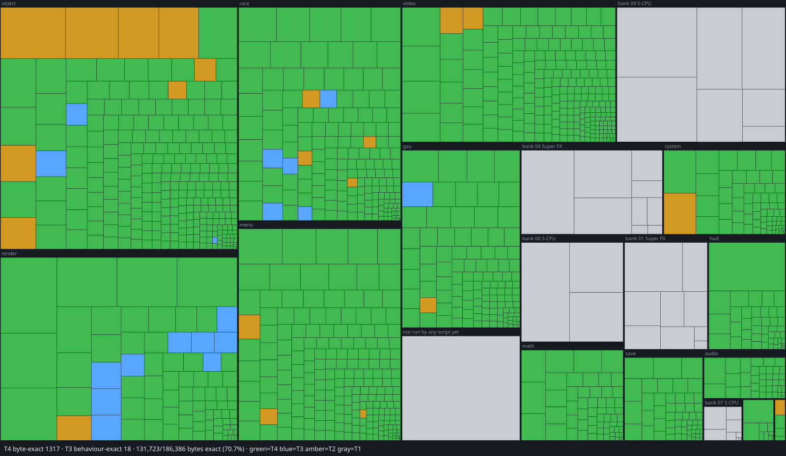

# Stunt Race FX: bit-exact & cycle-exact decompilation

**Complete: 100% of the game's code is decompiled, behaviour exact, byte
exact and cycle exact.** Started October 11, 2026; behaviour and byte exact
October 18, 2026; cycle exact on all three processors October 20, 2026.

> **Cycle exact, clock for clock, on every processor.** The C does not just
> compute what the original computes: it takes exactly as long to do it.
> Across all 325 scripts (161 of gameplay, 164 unit tests that reach debug
> screens, unused code and rarely taken branches), every interval the C
> states between two memory accesses matches the original's to the master
> clock, on the S-CPU (65816), the Super FX (GSU-1) and the SPC700 at once:
> **0 clocks off, every script identical.** See [Cycle-exact](#cycle-exact).

| | Behaviour exact (M1) | Byte exact (M2) |
|---|---|---|
| **All code** | **100%** (215,370 of 215,370 B) | **100%** (215,370 of 215,370 B) |
| S-CPU (65816) | 100% (150,944 B) | 100% |
| Super FX (GSU-1) | 100% (51,491 B) | 100% |
| SPC700 (sound) | 100% (12,935 B) | 100% |

- **Every routine is decompiled.** All 2,411 routines the routine census
  names, including code the game never runs, have C and commented, symbolic
  assembly in the tree, filed by area. The census finds no routine left
  unnamed and no orphaned code.
- **Every routine is proven behaviour exact.** Each C routine was checked
  against the running original at every call the scripts make (no call of
  any routine differs), and all of them were swapped in at once and run in
  lockstep with the original over 324 scripts, frame for frame (every script
  identical). Routines that never return (they restart or stop the game)
  are judged by that lockstep run.
- **The whole ROM rebuilds byte for byte** from the companion assembly.
- **Every routine is cycle exact.** With all the C in place, all 325 scripts
  run 0 master clocks off the original on the S-CPU, Super FX and SPC700.

The numbers are from the full gate on the final tree (`python3
tools/stuntracefx/gate.py --full`, with every script retraced); the
generated blocks under Current Status carry the same figures.

**Maintainer:** Jeffrey Wilbur, Strut B, LLC\
**Contact:** [retro@strutb.com](mailto:retro@strutb.com)

## License, and no claim to the game

**I claim no ownership whatsoever of the decompiled source code.** Stunt Race
FX, its code and its assets belong to its rights holders. The C and assembly
in this repository are a reconstruction of their work, recovered so that they
rebuild the original bytes. It is not mine to own, license or give away, and
nothing here says otherwise. No game data ships in this repository: every
build starts from your own copy of the cartridge.

This project exists for preservation and for love of this game, so that the
Super FX racer Nintendo and Argonaut made in 1994 can still be read, studied,
built and played long after the cartridges and hardware it shipped on are
gone.

The work that is my own (the tools, the test harness and the ports' platform
code) is dedicated to the public domain under [CC0 1.0 Universal](LICENSE).
Anyone may use it for any purpose, with no permission or credit needed.

**Why CC0.** A preservation project should claim as little as possible. CC0
asserts nothing over the reconstructed game, and it gives everything that is
mine to the public domain, with a fallback licence for countries where
copyright cannot be waived outright. That fallback is why CC0 was chosen over
the Unlicense, which has the same intent but no fallback.

## The Decompilation Standard

The purpose of a decompilation, as opposed to a recompilation, is
preservation: recovering the game itself, as written, in a form that outlives
the original hardware and media. Playability and portability are welcome side
effects, not the direct goal. With a bit-exact decompilation, every function,
built with the original compiler, must reproduce the original machine code
byte for byte. A bit-exact match is 100% reliability that the source is
accurate to the original, ensuring preservation for future generations.

## Project Purpose

A decompilation of **Stunt Race FX** (SNES, 1994): every routine rewritten
as readable C, documented with what it does and how, filed by what it is for,
and proven to behave exactly like the original; and the whole ROM rebuilt byte
for byte. Progress is measured only by those two proofs; playability is a
consequence, never a reason to reorder the work.

## Game background

Nintendo released *Stunt Race FX* in 1994 (*Wild Trax* in Japan), a 3D racer
on a cartridge that carries the Super FX coprocessor (GSU-1) and 64 KB of RAM
for it. The game is split across three processors: the SNES CPU (a 65816) runs
the game logic, the Super FX transforms and rasterises the polygons, and the
SPC700 sound CPU plays the music and effects from a program the main CPU
uploads at boot. The retail ROM has no compiler footprint at all; all three
programs were written by hand in assembly. *Star Fox* (1993) runs on the same
chip and its Super FX code is laid out the same way, starting from the same
kind of jump table, so its disassembly is a second witness for the engine.

## Two lanes, one game

When a game was compiled from C, the right C fed to the original compiler
gives back the original bytes, so one source carries both proofs. No compiler
produced these bytes, so no C can rebuild them. Each routine therefore has two
sources:

- **C, the decompilation.** Readable C per routine, certified behaviour exact
  against the running original (T3). The native port (below) is built from
  its own copy and never edits it.
- **Assembly, the byte-exact companion.** Symbolic, commented assembly that
  rebuilds the ROM byte for byte (T4). It is the reading the C is written
  from, and the byte-exact rebuild proves that reading is right.

## Cycle-exact

**Done: the whole decompilation is cycle exact on all three processors.**
This is the third proof, and the hardest. Behaviour exact says the C gives
the same answers; byte exact says the assembly is the same program. Cycle
exact says the C *is* the original in time as well: run in place of the
original code, it spends the same master clocks between every pair of memory
accesses, on the S-CPU, the Super FX and the SPC700 together.

| | Scripts | Clocks off | State |
|---|---|---|---|
| Gameplay (attract, Speed, Stunt, Battle Trax, Test Run, menus, seeded random play) | 161 | **0** | identical |
| Unit tests (debug screens, unused screens and code, rarely taken branches) | 164 | **0** | identical |
| **All** | **325** | **0** on S-CPU, Super FX and SPC700 | **identical** |

**How it is checked.** Each routine's C states the time its original
instructions take (`cyc(N)` on the S-CPU; on the Super FX, the code bytes
the C stands for, derived from the ROM; on the SPC700, its own clocks). The
lockstep run places every memory access the C makes on the original's
matching access, and compares the clocks the original spent since the
access before with the clocks the C stated: any difference, of even one
master clock, is a failure. Every number comes from the original's
instructions, never fitted to a measurement. Where one C helper stands for
code the original reaches several ways, each caller passes its own time.
The only interval in the whole run not compared is one in `unit_hud_colours`
that a state load cuts before the original returns: there is no original
return there to compare with.

**Why it matters.** On the SNES, timing *is* behaviour. When a frame drops,
where an interrupt lands mid-routine, when the S-CPU waits on the Super FX
for the shared bus, and when the sound CPU answers a command all depend on
exactly how long each piece of code takes. A decompilation that is only
behaviour exact can still play differently: a lag frame in another place, a
raster effect a line off, a sound a frame late. Cycle exact closes that
last gap. It is a complete record of how the original *runs*, not only of
what it computes, and it gives a native port the original's exact pacing to
keep, or to drop on purpose.

## Native port (in progress)

**The decompilation is done; the native port built from it is under way.**
`ports/stuntracefx` runs the game as a native 64-bit program on its own
copy of the decomp's C (`ports/stuntracefx/game`); the decompilation in
`src/` and `asm/` never changes for it. The goal is zero emulation: the
game's own code as plain C over native parts, with no console model, no
processor registers and nothing drawn in software, at the original's
pacing.

Where it stands (2026-10-23):

- **Plays the whole game** on macOS (a Windows target builds from the same
  tree), with the player's own ROM checked by SHA-1 and built into the
  executable; nothing derived from the cartridge is committed.
- **Picture on the GPU.** The 2D layers, sprites and colour effects are
  composed on Metal, Vulkan or OpenGL, identical to the reference renderer
  on every frame of the 21 plays the checks run. The Super FX's polygons are
  drawn on the GPU from the game's own draw lists, every pixel equal to the
  Super FX's.
- **Sound** through the port's own mixer: identical to the original's DSP
  for the attract mode's first 126,206 samples, then 1-2 levels off on one
  channel (open).
- **Pacing** is the original's: race frames take as many video frames as
  they did on the console, from the time the C states.
- **Now: the game's C as plain C.** The port's copy is being turned from
  code that works on an emulated 65816 register file into C that carries
  its own values. Each step is checked three ways: every routine of the
  whole game against the previous commit's from random states (every
  memory access, every clock, every exit register), every play byte for
  byte against the reference port, and the decomp's full gate. References
  to the register file left: 1,591, from 17,415 when the conversion began
  (`python3 ports/stuntracefx/tools/plainc.py`). What remains is code that
  works the stack directly (boot, the race loop, restarts, frames a callee
  pulls for its caller) and typed functions that still hand results back
  in registers; it is converted by hand.
- **Still to do:** the rest of that phase (typed work RAM, a frame loop
  with no interrupts, the Super FX programs and the sound drivers as
  native code); removing the console model (`ports/common/snes`) and every
  other stepping stone; widescreen and field of view; and last, as a
  remaster option, high-resolution polygons.

```sh
ports/stuntracefx/package_app.sh                    # macOS: Stunt Race FX.app
HOST=null ports/stuntracefx/link.sh                 # headless, for the checks
python3 ports/stuntracefx/tools/same.py             # every play byte for byte against the reference port
```

The plan and its rules are in [ports/stuntracefx/PLAN.md](ports/stuntracefx/PLAN.md),
the current state and every check in
[ports/stuntracefx/HANDOFF.md](ports/stuntracefx/HANDOFF.md).

## Current Status

**Both milestones are met: M1 and M2 are at 100%.** M1 counts routines whose
C is certified to behave exactly like the original (T3) plus those also
byte-exact (T4); M2 counts byte-exact routines only.
The blocks below are snapshots; regenerate the bars and the treemap in one step
with `python3 tools/stuntracefx/progress.py`: do not hand-edit them.

<!-- PROGRESS:BEGIN: generated by tools/stuntracefx/progress.py; do not edit by hand -->
_Snapshot 2026-10-18._

```
M1  Behaviour exact (T3 + T4)
    ████████████████████████████████████████  100.0%   215,373 / 215,373 B of the game's code
M2  Byte exact (T4)
    ████████████████████████████████████████  100.0%   215,373 / 215,373 B of the game's code
```

The bars measure the whole game's S-CPU, Super FX and SPC700 code, 215,373 B: 215,311 B the scripts have run and 62 B the [routine census](docs/stuntracefx/ROUTINE_CENSUS.md) finds that no script has run yet. Certified so far: 2401 routines behaviour exact, 2401 of them byte exact.

| Processor | M1: behaviour exact | M2: byte exact |
|---|---|---|
| **S-CPU (65816)** | `████████████████████` 100.0%: 150,947/150,947 B | `████████████████████` 100.0%: 150,947/150,947 B |
| **Super FX (GSU-1)** | `████████████████████` 100.0%: 51,491/51,491 B | `████████████████████` 100.0%: 51,491/51,491 B |
| **SPC700 (sound)** | `████████████████████` 100.0%: 12,935/12,935 B | `████████████████████` 100.0%: 12,935/12,935 B |
<!-- PROGRESS:END -->



Every box is one routine, sized by its executed code bytes and grouped by the
area it is filed in (or by ROM bank and processor until it is filed): green =
byte-exact (T4, M2), blue = behaviour exact but not yet byte-exact (T3), amber
= in the tree, not yet certified (T2), gray = not started (T1). Green + blue is
the M1 corpus.

## More

- [docs/stuntracefx/PLAN.md](docs/stuntracefx/PLAN.md): the plan and the standard.
- [docs/stuntracefx/HANDBOOK.md](docs/stuntracefx/HANDBOOK.md): what the work has learned, one rule per finding.
- [docs/stuntracefx/DECOMP.md](docs/stuntracefx/DECOMP.md): standard, layout and tools in one page.

## Stunt Race FX decompilation

<!-- PROGRESS-DETAIL:BEGIN: generated by tools/stuntracefx/progress.py; do not edit by hand -->
**What the bars measure.** Bytes of code, not routines. The denominator is
every S-CPU, Super FX and SPC700 code byte of the game, 215,373 B: the 215,311 B the scripts
have run and the 62 B the routine census (`tools/stuntracefx/census.py`) finds
by following the code statically (calls, jumps, tables, handler pointers,
Super FX calls, orphans) where no script has gone. The numerator is the code
bytes inside routines whose C is certified behaviour exact (T3) or whose
assembly is also byte exact (T4), for M1, and T4 only for M2. 0 routine(s)
are in the tree but not yet certified (T2).

**Why not routines.** A routine count keeps growing as the work goes on:
every entry point filed in C or reached by a new script splits code already
counted into more routines (the census now counts about 2,417, 2,417 of them
named), while the bytes stay put: tracing a new script moves bytes from
"found" to "run" and barely changes the total. Of the
ROM's 1,048,576 B, the scripts have run 202,376 B as code and read 606,580 B as data;
239,620 B have not been touched by any script. The SPC700 (sound CPU) runs
code the S-CPU uploads from ROM; the 12,935 B of it the scripts have run are
counted (folded back from APU RAM onto the uploaded ROM bytes, `tools/stuntracefx/spcmap.py`);
what no script has run there is not counted yet.

**Byte-exact rebuild.** Independently of the tiers, the whole ROM already
rebuilds byte for byte from source: filed, commented assembly where it
exists and the raw intake for everything else (`tools/stuntracefx/image.py`).
<!-- PROGRESS-DETAIL:END -->

Query the tree. Do not trust a number in this file.

```bash
python3 tools/stuntracefx/build.py              # trace, regenerate the raw intake, assemble
python3 tools/stuntracefx/image.py              # M2 gate: built ROM vs original, 0 differing bytes
python3 tools/stuntracefx/catalog.py            # routines and bytes the scripts have reached
python3 tools/stuntracefx/t3.py --live          # A5: every call of every C routine vs the original
python3 tools/stuntracefx/t3.py --image         # A7: all C in place, lockstep, every frame
python3 tools/stuntracefx/t3.py --qualify ADDR  # every gate for a routine, and its tier
python3 tools/stuntracefx/asmcontrol.py         # the assembler encodes every instruction form
```

T1 = traced, raw intake only; T2 = C or assembly in the tree, not certified;
T3 = the C is certified behaviour exact; T4 = T3, and the routine's assembly is
symbolic, documented and byte-identical in place.

### How T3 is verified

"Behaviour exact" means same input, same output, proven against the running
original. Both oracles run the **original game** headless on a pinned,
accuracy-first emulator core (bsnes, with its speed shortcuts off), driven by
input scripts in `tools/stuntracefx/scripts/`: attract mode, Speed Trax with
every car, all four Stunt Trax courses, two-player Battle Trax, Test Run,
seeded random play through the menus and races (`randplay.py`), and a boot
with the save area full of garbage, as a failed battery leaves it.

- **A5: per call** (`t3.py --live`, ledger `config/stuntracefx/t3_live.csv`): at
  every real call of a routine in the running game, its C runs on the same
  inputs (memory as it was at entry, the same registers, the original's
  hardware reads replayed) and must leave the same registers, memory and
  hardware writes. Calls an interrupt or DMA overlapped are reported, never
  judged; unreached routines are UNCOVERED, never passed.
- **A7: whole image** (`t3.py --image`, ledger `config/stuntracefx/whole_image.csv`):
  the game runs with every certified routine's C in place, in lockstep with the
  untouched original. The hybrid repeats each replaced call's exact bus cycles,
  so DMA, memory refresh and interrupts fall where they fell, and work RAM,
  Super FX RAM, VRAM, OAM, CGRAM and sound RAM must match after every frame.

A7 exists because a per-call check cannot see timing or ordering effects;
`t3.py --qualify` requires both, plus coverage of every byte of the routine.
Both gates are proven to have teeth: a deliberately broken copy of a certified
routine fails them.

### Keeping it that way

A routine is not done until it says what it does and how, and lives in the
folder for what it is for. The pre-commit hook refuses a new `@routine`
without `WHAT IT DOES:` and `HOW:`, and refuses a file named for an address
range anywhere outside the raw intake. Every commit and commit message also
passes the provenance check.

### Architecture

    src/stuntracefx/             the C decomp, by area; include/ holds the machine
                                 model (machine.h) and the RAM map (wram.h)
    asm/stuntracefx/             the companion assembly, same areas as the C;
                                 include/ holds macros and the RAM map (wram.inc)
    config/stuntracefx/          verdict ledgers
    tools/stuntracefx/           tracer, disassembler, build, gates, oracles, progress
    tools/stuntracefx/sfxbox/    the headless runner and both oracles
    tools/common/                git hooks, provenance check
    tools/toolchains/            pinned asar and bsnes (staged by setup.sh), local patches
    docs/stuntracefx/            plan, standard, handbook, dated notes
    ports/stuntracefx/           the native port: its copy of the game's C,
                                 runtime, build, checks, plan and handoff
    ports/common/                what any port shares: hosts (macOS, Windows,
                                 headless), the picture's records, GPU
                                 renderers, the mixer, and the console model
                                 the port is removing
    reference/                   ROMs and witness clones (not tracked)
    build/                       everything generated

The code is entered through dispatch tables on both processors, so routines
are taken bottom up: a routine's C calls its callees' C, which are certified
first.

### Building & Setup

- **`./setup.sh`**: stages the toolchain inside the repo (nothing installed on
  the host): asar 1.91 built from a pinned commit, and the bsnes core at a
  pinned commit with this project's patch (trace, oracle and lockstep hooks)
  applied, plus the headless runner.
- **`python3 tools/stuntracefx/build.py`**: runs the scripts with tracing (in
  parallel), regenerates the raw intake for every byte filed source does not
  own, and assembles the ROM. Data is included from your ROM at build time, so
  the tree carries none of it.

### Reference ROM (you supply; not tracked in git)

```
reference/stuntracefx/Stunt Race FX (USA) (Rev 1).sfc        the target
    SHA-1  781e376ff453a83c7bcf72339abe6b842efd9c86     1,048,576 bytes
    MD5    128b316a74caf17fdc216b3ab46d4a9a
reference/stuntracefx/Stunt Race FX (Europe).sfc             witness (optional)
    SHA-1  de21be64fde447d9c6a2f1b063d2f2e0d4034ca0
reference/stuntracefx/Wild Trax (Japan) (En) (Rev 1).sfc     witness (optional)
    SHA-1  b51199fa2afb0a161d6afdabfa0575513913dde1
```

`build.py` checks the target's SHA-1 and refuses any other image.
